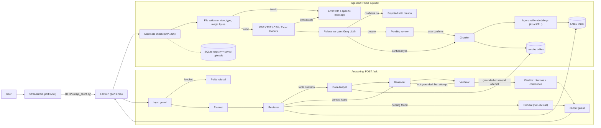
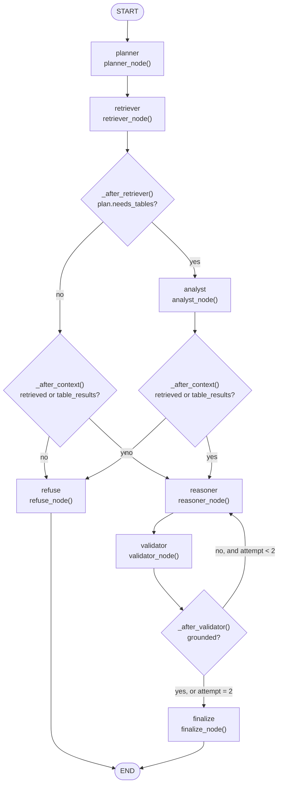
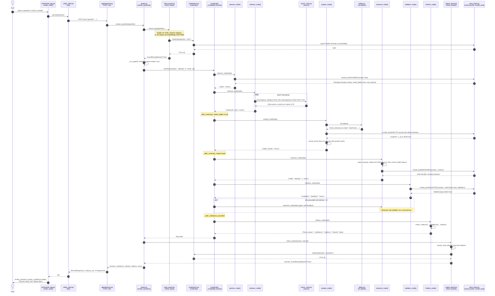

# OnboardIQ architecture

This document explains how OnboardIQ works and why it was built this way. For setup and usage, see [README.md](README.md). All numbers below come from the code (`app/config.py` and the module constants named in each section).

## System diagram

The agent graph itself (Planner to Finalize) is built in `app/agents/graph.py`. The guards wrap it in `answer_question`. If the knowledge base is empty, `answer_question` replies "No documents uploaded yet" without calling the LLM.

## Agent graph flow

### The LangGraph state graph

`build_graph()` in `app/agents/graph.py` wires these nodes. Boxes are nodes (with the function that implements each one), and diamonds are the routing functions on the conditional edges.

All nodes share one `AgentState` (`app/agents/state.py`). Each node returns only the keys it changes, and LangGraph merges them into the state. `trace` is the exception: it's declared with `operator.add`, so every node's trace step is appended rather than replaced.

| Node | Reads from state | Writes to state | Calls |
| --- | --- | --- | --- |
| `planner` | `question` | `plan` (`type`, `needs_tables`, `sub_queries`, `category_hint`) | `plan_question()` → `invoke_json(..., Plan)` |
| `retriever` | `plan.sub_queries`, `plan.category_hint` | `retrieved` (list of `ContextItem`) | `retrieve()` → `vector_store.search()` |
| `analyst` | `question` | `table_results` (list of `ContextItem`) | `analyse()` → `invoke_text()`, `extract_json()`, `run_query()` on `tables.all_tables()` |
| `reasoner` | `question`, `retrieved`, `table_results`, `feedback`, `attempt` | `draft`, `attempt` (+1) | `build_context()`, `format_context()`, `draft_answer()` → `invoke_text()` |
| `validator` | `question`, `draft`, `retrieved`, `table_results` | `validation` (`grounded`, `unsupported_claims`, `has_citations`), `feedback` | `validate_draft()` → `match_citations()`, `invoke_json(..., Validation)` |
| `refuse` | nothing | `final_answer`, `refused`, `confidence`, `citations` | none (no LLM call) |
| `finalize` | `draft`, `validation`, `retrieved`, `table_results` | `final_answer`, `refused`, `confidence`, `citations` | `match_citations()`, `_confidence()`, `_citation()` |

Every node also appends one `TraceStep` (`agent`, `summary`, `ms`) through the `timed()` context manager in `app/agents/context.py`.

### Object sequence for one question

This is the path of one question from the UI to the answer, using the real modules and functions. The example is a table question ("Who is Siddharth Patel's onboarding buddy and manager?"), so the Data Analyst runs.

**Where the flow ends early:**

| Situation | Where it stops | What the user sees |
| --- | --- | --- |
| Input guard blocks the question | `answer_question`, before the graph | The guard's message (for example the off-topic reply) |
| Knowledge base is empty | `_run_graph`, before the graph | "No documents uploaded yet. Upload onboarding documents first." |
| No chunks above 0.35 and no table results | `refuse_node`, without calling the Reasoner | "I could not find this in the uploaded onboarding documents." |
| Still not grounded after 2 attempts | `finalize_node` | The same refusal, with Low confidence |
| Answer has no citations or is flagged unsafe | `check_output` | The refusal |
| Groq error (rate limit, auth, unavailable) | `_run_graph` catches the `LLMError` | The API returns HTTP 503 with a plain message, and the UI shows it as a warning |

To step through this flow in the debugger, use the **Ask a question (CLI)** launch configuration and the breakpoint spots listed in the README's Debugging section.

## Ingestion flow

One file goes through `ingest_file` in `app/ingestion/pipeline.py`. `ingest_many` runs each file separately, so one bad file never blocks the rest of a batch. Each stage is timed in the log.

**1. Duplicate check.** The file's SHA-256 hash is looked up in the registry (`app/ingestion/registry.py`, SQLite at `data/registry.db`). A repeat upload gets a "duplicate" result that says when it was first uploaded and what happened to it.

**2. Validation** (`app/ingestion/validator.py`). Cheap checks run first, before anything is parsed or sent to an LLM, in this order:

| Check | Example message |
| --- | --- |
| Empty file | "File is empty." |
| Size of at least `MAX_FILE_MB` (19 MB) | "File is 20.0 MB. Maximum allowed is under 19 MB." |
| Image extension | "Images are not supported. Upload text-based documents (PDF, TXT, CSV, Excel)." |
| Archive extension | "Archives are not supported. Extract the files and upload them individually." |
| Word or PowerPoint | "Word/PowerPoint not supported. Export as PDF and re-upload." |
| Macro-enabled Excel (`.xlsm`, `.xltm`, `.xlsb`) | "Macro-enabled Excel files are not supported. Save as .xlsx and re-upload." |
| Any other extension | "Unsupported file type '.exe'. Allowed: PDF, TXT, CSV, XLSX, XLS." |
| Content doesn't match the extension | "This file claims to be PDF but its content looks like JPEG." |

PDF, XLSX and XLS are checked against their magic bytes. TXT and CSV must contain no NUL bytes in the first 64 KB. Streamlit enforces the same limit in `.streamlit/config.toml` (`maxUploadSize = 19`), and the API rejects request bodies larger than 20 files' worth with HTTP 413.

**3. Loading** (`app/ingestion/loaders.py`). `pypdf` reads PDFs page by page; TXT is decoded as UTF-8 with a latin-1 fallback; CSV and Excel are read with pandas (`openpyxl` for XLSX, `xlrd` for XLS), one DataFrame per sheet. Damaged, password-protected and scanned PDFs (fewer than 20 characters of text) and unreadable Excel files get their own messages and are recorded as errors.

**4. Relevance gate** (`app/ingestion/relevance.py`). A profile is built from the filename plus the first 2 pages, or each sheet's name, row count, columns and first 5 rows, capped at 3,000 characters. The chat model returns `{relevant, category, confidence, reason}` as JSON. The categories are `hr_policy`, `benefits`, `it_setup_security`, `code_of_conduct`, `team_directory`, `training_schedule`, `onboarding_checklist`, `payroll_leave`, `facilities_faq` and `other`.

| Verdict | Result |
| --- | --- |
| Confidence of at least `RELEVANCE_THRESHOLD` (0.75) and relevant | Indexed |
| Confidence of at least 0.75 and not relevant | Rejected, with the model's reason |
| Confidence below 0.75 | Pending review: the user confirms or discards it in the UI |

If the model says "relevant" but picks `other`, its confidence is capped just below the threshold, so a person decides. If there is no API key or the LLM call fails, an embedding fallback compares the profile with the category descriptions. It suggests the closest category when similarity is at least 0.45, but bge similarities rarely reach 0.75, so fallback decisions go to Pending review. The decision, category, confidence and reason are stored in the registry, and accepted uploads are saved under `data/uploads/`.

**5. Chunking** (`app/ingestion/chunker.py`).

- **Prose (PDF, TXT):** a recursive splitter measured in tiktoken tokens, 700 tokens per chunk with 100 tokens of overlap. PDFs are split page by page, so each chunk keeps its page number.
- **Tables (CSV, Excel):** groups of 25 rows rendered as Markdown, each repeating the header and starting with `Source: <file>, rows 26-50` (or `sheet <name>, rows ...`).

Each chunk's metadata carries `doc_id`, `chunk_id`, `source`, `category` and the page or row range. Table DataFrames are also registered in the in-memory table store (`app/store/tables.py`) for the Data Analyst.

**6. Indexing.** Chunks are embedded and added to FAISS, which is saved to `data/faiss_index/`. If the registry write fails, the chunks are removed again so FAISS and the registry stay consistent.

## Agent roles

| Agent | Input | Output | LLM? | Failure behaviour |
| --- | --- | --- | --- | --- |
| Input guard (`app/guardrails/input_guard.py`) | The question | Allowed, or blocked with a reason code and message | Moderation only (guard model) | Moderation failures fall back to keyword rules; the question is never blocked because a call failed |
| Planner (`app/agents/planner.py`) | The question, the available table names | Type (`policy`, `people_lookup`, `schedule`, `mixed`), `needs_tables`, 1 to 3 search sub-queries, optional category hint | Yes, JSON | No sub-queries means the question itself is used; with no tables loaded, `needs_tables` is forced off. LLM errors end the run with a plain message |
| Retriever (`app/agents/retriever.py`) | Sub-queries, category hint | Up to `TOP_K` (5) chunks with scores | No | No chunks above the threshold and no table results means the refusal path, without calling the Reasoner |
| Data Analyst (`app/agents/analyst.py`) | The question, table schemas with example values, today's date | Up to 3 table query results with row numbers | Yes, JSON query spec | Runs only when the Planner sets `needs_tables`. Invalid JSON or unknown tables or columns are logged and skipped; the answer continues from the chunks |
| Reasoner (`app/agents/reasoner.py`) | The question, context blocks, the Validator's feedback on a retry | A draft answer with `[file, location]` citations, or the exact refusal sentence | Yes, text | Told to reply with the refusal sentence when the context doesn't contain the answer |
| Validator (`app/agents/validator.py`) | The question, the draft, the context blocks it cites | `grounded`, unsupported claims, `has_citations` | Yes, JSON | A draft without citations fails without an LLM call. An ungrounded draft goes back to the Reasoner once (`MAX_ATTEMPTS = 2`); after that the answer becomes the refusal |
| Finalize (`app/agents/graph.py`) | The draft and the validation result | The final answer, the cited sources with snippets, a confidence label | No | Ungrounded or refusal drafts become the refusal sentence with Low confidence |
| Output guard (`app/guardrails/output_guard.py`) | The final answer | The answer to show | Moderation only | Strips leaked `<think>` and "system:" lines. An answer with no citations, or one flagged as unsafe, is replaced with the refusal |

Every agent records a trace step (agent name, summary, milliseconds), which the UI shows under "Agent steps". The graph runs with `stream(..., stream_mode="values")`, so the trace up to the failure point survives an error.

## Retrieval and RAG

- **Embeddings** (`app/store/embeddings.py`): `BAAI/bge-small-en-v1.5` through `langchain-huggingface`, 384 dimensions, on CPU, with normalized vectors. Queries get the bge instruction prefix ("Represent this sentence for searching relevant passages: ").
- **Vector store** (`app/store/vector_store.py`): a LangChain FAISS wrapper over `IndexFlatIP`. Because the vectors are normalized, inner product is cosine similarity (in practice between 0 and 1 for this model). The index is loaded once and protected by a lock.
- **Search:** for each sub-query, the Retriever first searches within the Planner's category hint. If that returns fewer than 5 hits, it also searches without the filter. Filtered searches look at `max(50, 10 x k)` candidates before filtering. Hits below `SIMILARITY_THRESHOLD` (0.35) are dropped. Results from all sub-queries are de-duplicated by `chunk_id` (keeping the best score), and the top 5 are kept.
- **Table lookups:** the Data Analyst asks the LLM for a structured query, not code: a table, filters (`==`, `!=`, `contains`, `>`, `<`, `>=`, `<=`), columns, sort, a limit of up to 50 rows, and an optional `count`, `sum`, `mean`, `min` or `max`. It runs the query with pandas boolean masks, so no `eval` or generated code ever runs. Dates are compared as dates, and "upcoming" filters sort earliest first. Results cite the real row numbers (for example `rows 160`).
- **Context budget** (`app/agents/context.py`): table results go first, within 1,000 tokens, then chunks by score, within 1,800 tokens. Both are counted with tiktoken. This keeps each request inside Groq's free-tier limit of 8,000 tokens per minute.
- **Prompt** (`app/agents/prompts.py`): use only the context, cite every factual sentence with the block label exactly as written, prefer "Table query:" blocks for lookups, answer in 1 to 5 sentences, and otherwise reply with exactly "I could not find this in the uploaded onboarding documents."
- **Citation format:** `[employee_handbook.pdf, p.2]` for prose, `[team_directory.csv, rows 160]` for CSV, and `[training_schedule.xlsx, Session Schedule, rows 12-14]` for Excel. Citations are matched back to the context blocks, ignoring spacing and case, and accepting a shortened sheet label, so the UI can show the snippet for each source.
- **Confidence:** High when the answer is grounded and its best cited score is at least 0.6, Medium at 0.45 or more, otherwise Low. A table query result counts as a score of 0.75, because it's an exact lookup.
- **LLM settings** (`app/llm/groq_client.py`): the model is `GROQ_MODEL` (`qwen/qwen3.8-27b`), with temperature 0.1 for text and 0.0 for JSON. Output is capped at `GROQ_MAX_TOKENS` (800) and requests time out after 60 seconds. Qwen3's reasoning is hidden with `reasoning_format="hidden"`, and any leftover `<think>` block is stripped. JSON calls try structured output first, then fall back to asking for plain JSON and extracting the first balanced `{...}` object.

## Safety

**Input guard**, in order (cheapest first):

1. Empty, or outside 3 to 1,000 characters: blocked.
2. Prompt injection: 11 regular expressions ("ignore previous instructions", "system prompt", "you are now", "developer mode", "jailbreak" and similar). Blocked with "I can only answer questions about your onboarding documents."
3. Off-topic: blocked only if **both** the question's best similarity to an onboarding category is below `OFF_TOPIC_THRESHOLD` (0.45) **and** its best search hit is below `OFF_TOPIC_SEARCH_THRESHOLD` (0.50). Requiring both avoids blocking real questions about company-specific content. This check is local, so it runs before the rate-limited moderation call.
4. Moderation of the question.

**Guard model and fallback** (`app/guardrails/moderation.py`): `GROQ_GUARD_MODEL` defaults to `openai/gpt-oss-safeguard-20b`, which gets a written policy with categories S1 to S8 (violence, crime, sexual content, child exploitation, hate, self-harm, weapons, malicious code). Normal HR questions and security how-tos are explicitly allowed. `meta-llama/llama-guard-*` models are also supported, using their native format. If the key is missing, the model isn't available for the key (checked once against Groq's `/models` list), or a call fails, keyword rules for violence, weapons, self-harm and illegal activity take over. Moderation calls skip the retry loop: on a rate limit it falls back at once instead of making the user wait. Results are cached for repeated text.

**Output guard:** removes leaked reasoning and "system:" lines, requires at least one citation, and moderates the answer. Refusals and error messages pass through unchanged.

**Validator loop:** described in the agent table. Together with the Retriever's threshold and the Reasoner's refusal rule, this is the main protection against hallucination: an answer has to retrieve something, cite it, and pass a claim-by-claim grounding check.

**PII handling** (`app/guardrails/pii.py`): emails, US SSNs, phone numbers (10 or more digits, so dates stay readable) and long digit runs (9 or more) are masked in every log line that contains a question, answer or moderation input. Answers themselves aren't masked, because contact details from the uploaded directory are legitimate answers.

**Error handling:**

- **Groq retries:** rate limits get up to 6 attempts within about 60 seconds. Each wait is the longer of Groq's `retry-after` plus 0.5 seconds and 2, 4, 8, 16 seconds, capped at 20 seconds, because Groq's `retry-after` is often shorter than the time the per-minute budget needs to recover. Timeouts, connection errors and 5xx get 3 attempts with 1 to 4 second backoff. "Request too large" (also a 429) is never retried.
- **Plain messages:** errors become `LLMAuthError`, `LLMRateLimitError` or `LLMUnavailableError`, each with a message the user can act on (for example "Lower GROQ_MAX_TOKENS in .env or ask a shorter question").
- **API** (`app/api/main.py`): LLM errors return HTTP 503, and anything unexpected returns HTTP 500 with "Something went wrong. Please try again.". No stack traces reach the user. Every response carries an `X-Request-ID`, which also appears in the log.
- **Startup:** the API warms up the embedding model, FAISS, tables, topic vectors and the Groq model check, logging and continuing past any failure. `/health` reports the key and model status, and the UI shows a banner when something is wrong.
- **Recovery:** a FAISS index that fails to load is deleted and rebuilt from the registry's saved uploads.
- **Logs:** `logs/app.log`, rotated at 5 MB with 3 backups.

## Design decisions and trade-offs

**FAISS over Chroma.** FAISS runs in-process with no server and saves to two files in `data/faiss_index/`, and LangChain's wrapper supports metadata filters and deleting by ID. For a few thousand chunks, an exact `IndexFlatIP` search takes well under a millisecond, so no approximate index is needed. Trade-offs: metadata filtering happens after the search (hence `fetch_k`), the index has to be saved after every change, and concurrent writers need the in-process lock. Chroma would give built-in persistence and filtering but adds a heavier dependency for no gain at this size.

**bge-small for embeddings.** It is free, needs no key, runs locally on CPU (about 130 MB), produces compact 384-dimension vectors, and scores well on retrieval benchmarks for its size. Trade-offs: it is English-only, and it reads at most 512 of its own tokens. A 700-token chunk can be slightly longer than that, so its tail may not count towards the embedding, though the full chunk text still goes to the LLM. Torch is installed from the CPU-only index; the README explains why.

**Groq for the LLM.** It has a free tier, very fast inference and an OpenAI-compatible API, and it hosts both a capable reasoning model (Qwen3) and a safety model on the same key. Trade-off: the free-tier limits of about 8,000 tokens per minute, 1,000 output tokens per minute and about 200,000 tokens per day per model. These limits shaped the 800-token output cap, the context budgets, the retry policy, and the decision to moderate only once per question and answer.

**A relevance gate before chunking.** Irrelevant files (a recipe, sales figures) would otherwise pollute retrieval and could surface in answers. One LLM call per upload keeps the index clean, explains every rejection, and avoids embedding content nobody needs. The "pending review" band means the model never silently drops a borderline document: a person decides.

**A Data Analyst instead of retrieval alone for tables.** Retrieval only sees 25-row slices, so questions like "who is X's manager" in a 184-row directory, "how many new hires are in Sales" or "the next session after today" can't be answered reliably from chunks. A structured, whitelisted query over the full DataFrame gives exact answers with real row citations, and it never executes generated code.

**LangGraph for orchestration.** The flow has real branches (tables or not, refuse or answer) and a retry loop. A state graph makes these explicit and testable, and gives every step a trace entry.

**A SQLite registry plus saved uploads.** It provides de-duplication, the document list, pending reviews, previews, deletion, and the ability to rebuild FAISS, all without a database server.

## Challenges faced

> **TODO: review and personalise.** This is a draft from the build notes; rewrite it in your own words and keep the ones you can talk about.

- **Hidden reasoning output.** Qwen3 is a reasoning model, and its `<think>` blocks leaked into answers and broke JSON parsing. The fix was `reasoning_format="hidden"`, plus a `strip_think` pass on every response (including unclosed blocks) and a balanced-brace JSON extractor as a fallback.
- **Garbled tool-call JSON.** In tool-calling mode, the model mangled the keys of the Data Analyst's nested query schema. The Analyst now asks for plain JSON text and validates it with strict Pydantic models (`extra="forbid"`), so a bad reply fails cleanly instead of running a wrong query.
- **Groq "Request too large".** `/ask` failed with a 503 after about 16 seconds. The cause was not a temporary rate limit: without `max_tokens`, each call reserved 2,048 output tokens, more than the free tier's 1,000 output tokens per minute. Groq reports this as a 429 too, so the retry loop wasted time on it. The fix was `GROQ_MAX_TOKENS=800`, never retrying "too large" errors, and a message that tells the user what to change.
- **Retry waits that were too short.** Groq's `retry-after` header was often a few seconds even when the minute's budget was still spent, so retries ran out too quickly. Waits now grow each attempt (2, 4, 8, 16 seconds, capped at 20) within a 60-second window.
- **The daily token limit during the eval.** The 20-question eval used up the 200,000 tokens per day allowance. `scripts/run_eval.py` now stops early and writes partial results marked as incomplete instead of losing everything.
- **Time zones.** The registry stores times in UTC, so duplicate-upload messages showed the next day's date in the evening. Stored times are now converted to local time for display. While testing, "next session" answers also looked a day off because the shell's Python clock reported UTC. That was an environment quirk, but it's why the Analyst and Reasoner prompts state today's date explicitly.
- **The guard model.** Llama Guard 4 wasn't available on every key, so the default became `openai/gpt-oss-safeguard-20b` with a written policy. A rule-based fallback keeps moderation working when the model is missing or rate-limited.
- **Off-topic false positives.** Similarity to the generic category descriptions alone blocked real questions about company-specific content. The off-topic check now also requires the best search hit to be weak, and the thresholds were tuned against the sample questions.
- **The relevance fallback.** bge similarities rarely reach the 0.75 relevance threshold, so the no-key fallback could never auto-index. It now only suggests a category and sends files to Pending review.
- **Losing the trace on errors.** An exception inside `graph.invoke` lost every completed step. Streaming with `stream_mode="values"` keeps the last state, so the UI still shows how far the answer got.
- **Token cost of validation.** Sending the whole context to the Validator doubled the tokens per question. It now sends only the blocks the draft cites, which also checks that the citations point to real context.
- **Dollar amounts in the UI.** Streamlit read `$` in amounts as LaTeX and garbled answers. The UI escapes `$` before rendering.

## Limitations and future work

- **OCR:** scanned PDFs and images are rejected. Adding OCR (for example Tesseract or a vision model) would cover scanned forms and badges.
- **Multi-language support:** the embedding model and prompts are English-only. A multilingual embedding model (such as `bge-m3`) and language-aware prompts would be needed.
- **Authentication:** there is no login. Anyone who can reach the UI can upload, delete and ask. SSO, roles (HR admin and employee) and an audit log are the next step.
- **Multi-tenant storage:** one FAISS index, one registry and one table store are shared by everyone. Per-company or per-team indexes with access filtering would allow several organisations or departments.
- **Streaming answers:** answers appear only when the whole graph finishes, typically several seconds. Streaming the Reasoner's tokens and the agent steps to the UI would feel much faster.
- **Retrieval quality:** hybrid search (BM25 plus embeddings), a re-ranker, and chunks sized to the embedding model's 512-token window would improve recall on exact terms and long sections.
- **Scale:** ingestion runs inside the request. Large batches would need a background job queue, and a larger corpus an approximate FAISS index or a vector database server.
- **Document updates:** a changed file is treated as a new upload. Versioning that replaces the old document would keep answers current.
