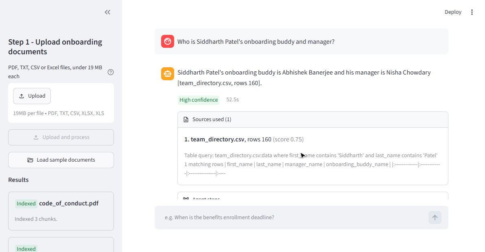

# OnboardIQ

An agentic RAG assistant that answers new-hire questions from your company's onboarding documents, with citations.

You upload handbooks, policies, FAQs, directories and schedules (PDF, TXT, CSV or Excel). OnboardIQ checks each file, keeps only onboarding material, and indexes it. A five-agent LangGraph pipeline then answers questions such as "Who is my onboarding buddy?" with citations to the exact page or rows. If the answer isn't in the documents, it says so instead of guessing.



For how it works inside, see [ARCHITECTURE.md](ARCHITECTURE.md).

## Features

- **Supported formats:** PDF (text-based), TXT, CSV, XLSX and XLS, up to 19 MB per file and 20 files per upload. Each file gets a clear status: Indexed, Rejected, Pending review or Error.
- **Validation with specific messages:** empty files, oversize files, images, archives, Word/PowerPoint, macro-enabled Excel, renamed files whose content doesn't match the extension, damaged, password-protected and scanned PDFs, and duplicates are each rejected with a message that says what to do.
- **Relevance gate before indexing:** an LLM reads a short profile of each file (filename, first pages or table columns and rows) and decides if it is onboarding material. Confident "yes" is indexed, confident "no" is rejected (for example a pasta recipe), and anything unsure waits in **Pending review** for a person to confirm or discard. Without an API key, an embedding-based fallback suggests a category and sends the file to review.
- **Two chunking strategies:** prose is split into about 700-token chunks with 100 tokens of overlap; tables are split into 25-row chunks that repeat the header and keep row numbers. Embeddings use `BAAI/bge-small-en-v1.5`, stored in a local FAISS index.
- **Five agents (LangGraph):**
  1. **Planner** classifies the question and writes search sub-queries.
  2. **Retriever** runs top-k search with a similarity threshold and a category filter.
  3. **Data Analyst** (only for table questions) asks the LLM for a structured query and runs it with pandas, so lookups and counts use the real rows.
  4. **Reasoner** drafts an answer from the retrieved context only, citing `[file, page]` or `[file, rows]`.
  5. **Validator** checks that the draft is supported by what it cites and sends it back to the Reasoner once if not.
- **Guardrails:** length checks, prompt-injection patterns, an off-topic check, and moderation with Groq's safeguard model (`openai/gpt-oss-safeguard-20b`, with a rule-based fallback). The output guard strips leaked system text, refuses answers without citations, and moderates the answer too. Emails, phone numbers and ID numbers are masked in the logs.
- **Citations and confidence:** every answer shows its sources with snippets, a High, Medium or Low confidence badge, and the agent steps with timings.
- **Reliable LLM calls:** Groq calls retry on rate limits and timeouts using the server's `retry-after`, output is capped at 800 tokens to stay under the free tier's per-minute limit, and errors become plain messages instead of stack traces.

## Quick start (uv)

> **Important: this project uses uv, not pip. There is no `requirements.txt` on purpose.**
> Dependencies are declared in `pyproject.toml` and pinned to exact versions in `uv.lock`. `uv sync` reads both, creates `.venv` with Python 3.11, and installs everything, including the CPU-only torch build. **Run `uv sync` first**, then start the app with `uv run ...` as shown below. `uv run` uses `.venv` automatically, so you don't need to activate it.

You need [uv](https://docs.astral.sh/uv/) (install commands are in [Local setup details](#local-setup-details)) and a free Groq API key from https://console.groq.com/keys. uv installs Python 3.11 for you.

```powershell
uv sync
Copy-Item .env.example .env   # macOS/Linux: cp .env.example .env
```

Open `.env` and set `GROQ_API_KEY`. Then start the API in one terminal:

```powershell
uv run uvicorn app.api.main:app --host 127.0.0.1 --port 8766
```

And the UI in a second terminal:

```powershell
uv run streamlit run ui/streamlit_app.py
```

Open http://localhost:8765, click **Load sample documents** in the sidebar, and ask one of the sample questions. The API docs are at http://127.0.0.1:8766/docs.

The first start takes longer because the embedding model (about 130 MB) downloads once and is then cached.

**In Cursor or VS Code**, you can skip the two terminals: after `uv sync` and creating `.env`, open Run and Debug (Ctrl+Shift+D), choose **Full stack: API + UI** and press F5. See [Debugging](#debugging) for all the launch configurations.

## Local setup details

**Install uv**

- Windows (PowerShell): `powershell -ExecutionPolicy ByPass -c "irm https://astral.sh/uv/install.ps1 | iex"`
- macOS and Linux: `curl -LsSf https://astral.sh/uv/install.sh | sh`

Open a new terminal afterwards so `uv` is on your PATH.

**Python 3.11:** the project pins Python 3.11 in `.python-version` and `pyproject.toml`. `uv sync` downloads it if needed; you can also run `uv python install 3.11` first.

**CPU-only torch:** `pyproject.toml` pulls `torch` from the PyTorch CPU index (`pytorch-cpu`) instead of PyPI. The reasons:

- **Torch is only needed for embeddings.** `sentence-transformers` uses it to run `BAAI/bge-small-en-v1.5`. Nothing else in the app uses torch.
- **A GPU adds nothing here.** bge-small is a small model (about 130 MB). On a laptop CPU, embedding a question takes milliseconds and indexing the sample documents takes seconds. The heavy work (answers, relevance checks, moderation) runs on Groq's servers.
- **It avoids a multi-gigabyte install on Linux.** On Linux, PyPI's `torch` is the CUDA build plus NVIDIA libraries, about 2 to 3 GB, which is useless without an NVIDIA GPU. The CPU build is a few hundred MB. On Windows and macOS the PyPI build is already CPU-only, so there the setting changes little.
- **Everyone runs the same build.** `uv.lock` pins the CPU wheel for every platform, so an evaluator, CI and your machine all install the same thing.

You can remove the `pytorch-cpu` index and the `[tool.uv.sources]` entry if you want GPU embeddings, then run `uv lock`. The app works the same either way.

**Embedding model:** `BAAI/bge-small-en-v1.5` downloads from Hugging Face on first use into your Hugging Face cache (`~/.cache/huggingface`, or `%USERPROFILE%\.cache\huggingface` on Windows). After that it works offline.

**Data and logs:** uploads, the SQLite registry and the FAISS index live in `data/`, and logs in `logs/app.log`. Both folders are created on first run and are git-ignored. Delete `data/` to start over.

**If you can't use uv (pip only):** uv is the supported way to run this project. If you must use pip, you can generate a pinned requirements file from the lock file, then install it into a Python 3.11 virtual environment:

```powershell
uv export --no-hashes --no-emit-project --format requirements-txt -o requirements.txt   # needs uv once
python -m venv .venv
.venv\Scripts\activate          # macOS/Linux: source .venv/bin/activate
pip install --extra-index-url https://download.pytorch.org/whl/cpu -r requirements.txt
pip install --no-deps -e .
```

Then run the same commands as in the quick start without `uv run`, for example `uvicorn app.api.main:app --host 127.0.0.1 --port 8766` and `streamlit run ui/streamlit_app.py`.

**Platforms:** developed and tested on Windows 11 with PowerShell. The commands are the same on macOS and Linux, apart from `cp` instead of `Copy-Item`.

## Configuration

All settings are read from `.env` (see `.env.example`) by `app/config.py`.

| Variable | Default | What it does |
| --- | --- | --- |
| `GROQ_API_KEY` | (none) | Your Groq API key. Required for answers; never commit it. |
| `GROQ_MODEL` | `qwen/qwen3.8-27b` | Chat model for the relevance gate and all agents |
| `GROQ_GUARD_MODEL` | `openai/gpt-oss-safeguard-20b` | Moderation model for the input and output guards. Any `meta-llama/llama-guard-*` model also works. |
| `GROQ_MAX_TOKENS` | `800` | Output cap per LLM call. Keep it below your plan's output-tokens-per-minute limit (1000 on the free tier). |
| `EMBEDDING_MODEL` | `BAAI/bge-small-en-v1.5` | Hugging Face embedding model. Changing it needs a fresh index (delete `data/`). |
| `MAX_FILE_MB` | `19` | Files must be smaller than this |
| `TOP_K` | `5` | Chunks retrieved per search |
| `SIMILARITY_THRESHOLD` | `0.35` | Chunks scoring below this are dropped |
| `RELEVANCE_THRESHOLD` | `0.75` | Relevance-gate confidence needed to index or reject automatically; below it the file goes to Pending review |
| `OFF_TOPIC_THRESHOLD` | `0.45` | Questions below this similarity to onboarding topics may be off-topic... |
| `OFF_TOPIC_SEARCH_THRESHOLD` | `0.50` | ...but only if their best search hit is also below this |
| `API_URL` | `http://127.0.0.1:8766` | Where the UI finds the API |
| `DATA_DIR` | `data` | Uploads, registry and FAISS index (relative paths are under the project folder) |
| `LOG_DIR` | `logs` | Log folder (`app.log`, rotated at 5 MB) |

## Usage walkthrough

1. **Upload:** in the sidebar, choose files and click **Upload and process**, or click **Load sample documents** to add the 9 Northwind Labs sample files from `docs/sample_data`. Each file shows its status and reason. Try `docs/sample_data/irrelevant/pasta_recipe.txt` (rejected) or `docs/sample_data/invalid/photo.jpg` (error) to see the checks.
2. **Review:** files in **Pending review** have **Confirm** and **Discard** buttons. The **Knowledge base** list shows what is indexed; you can preview or delete each document.
3. **Ask:** type a question or click a sample question. Try these with the sample data:
   - "Who is Siddharth Patel's onboarding buddy and manager?" (a table lookup by the Data Analyst)
   - "What is the benefits enrollment deadline for someone who started on 19 October 2026?"
   - "When is the next Security Awareness session in IST?"
   - "How many days of earned leave do employees in India get, and how much can be carried forward?"
4. **Read the answer:** check the confidence badge, open **Sources used** for the cited snippets, and **Agent steps** to see what each agent did and how long it took. Questions outside the documents, such as "What is our stock price?", get a polite refusal.

You can also ask from the terminal without the UI:

```powershell
uv run python scripts/ask.py "When is the next Security Awareness session in IST?"
```

## Testing

```powershell
uv run pytest -q              # offline suite: no network, Groq is mocked
uv run pytest -m live -q      # live tests: real Groq calls, needs GROQ_API_KEY
uv run python scripts/run_eval.py
```

- The offline suite covers the validator, loaders, chunker, relevance gate, vector store, pipeline, agents, guardrails, API and UI (Streamlit `AppTest`). Tests marked `slow` load the real embedding model; skip them with `-m "not slow and not live"`.
- `scripts/run_eval.py` asks the 20 questions in `tests/eval_questions.yaml` (15 answerable, 5 that should be refused), scores answers, citations and refusals, and writes [docs/eval_results.md](docs/eval_results.md). It ingests the sample documents first if the index is empty. Use `--only <id>` to run single questions.
- The Groq free tier allows about 200,000 tokens per day per model. A full eval uses a large share of that, so run it on a fresh day's quota. If the limit is hit, the script stops and writes partial results marked incomplete.

## Debugging

### F5 in Cursor / VS Code

Open **Run and Debug** (Ctrl+Shift+D), pick a configuration and press F5. All configurations load `.env`, run from the project folder and use `justMyCode: false`, so you can step into LangChain and LangGraph too.

| Configuration | What it does |
| --- | --- |
| API: FastAPI (uvicorn) | Starts the API on http://127.0.0.1:8766 (docs at `/docs`) |
| UI: Streamlit | Starts the UI on http://localhost:8765 |
| Full stack: API + UI | Starts both; stopping one stops the other |
| Ingest sample data (CLI) | Rebuilds the index from `docs/sample_data` (`--reset --include-invalid`) |
| Ask a question (CLI) | Prompts for a question and runs the full agent graph in-process |
| Pytest: current file | Runs the test file that is open in the editor |
| Pytest: all tests | Runs the whole test suite |
| Attach to process (port 5678) | Attaches to a process started with `debugpy --listen 5678` |

The configurations need the **Python Debugger** extension (`ms-python.debugpy`). If the wrong interpreter is used, run "Python: Select Interpreter" and choose `.venv\Scripts\python.exe`.

### Notes on `.vscode/launch.json`

- **Before the first F5:** run `uv sync` so `.venv` exists, and create `.env`. Every configuration loads `${workspaceFolder}/.env` through `envFile` (and `app/config.py` reads it too). Without it, the API and UI still start, but `/health` reports the Groq key as missing and questions fail.
- **Interpreter:** `.vscode/settings.json` points at `.venv\Scripts\python.exe`, which is the Windows path. On macOS or Linux, select `.venv/bin/python` with "Python: Select Interpreter" instead.
- **What each configuration runs:**
  - The API configuration runs `uvicorn app.api.main:app --host 127.0.0.1 --port 8766 --reload --reload-dir app`, so saving a file under `app/` restarts the API.
  - The UI configuration runs `streamlit run ui/streamlit_app.py --server.port 8765`.
  - The compound **Full stack: API + UI** starts both with `stopAll`, so pressing Stop on either one ends both. Use the debug toolbar's dropdown to switch between the two sessions.
- **Ingest sample data (CLI) resets your data:** it passes `--reset --include-invalid`, which clears the FAISS index, the registry and stored uploads, then ingests every sample folder, including `irrelevant/` and `invalid/` (those files show as Rejected or Error by design). Stop the API first, because it keeps its own copy of the index in memory.
- **Ask a question (CLI)** prompts for the question through the `question` input (default: "Who is Siddharth Patel's onboarding buddy?") and runs the whole graph in the debugger process, so you don't need the API running.
- **Pytest configurations** use the `addopts` in `pyproject.toml`, so live tests are skipped. To debug a live test, add `"-m", "live"` to that configuration's `args`. `settings.json` also turns on the Testing view (beaker icon) with pytest on `tests/`.
- **Ports already in use:** if F5 reports that port 8766 or 8765 is taken, an API or UI started from a terminal is still running. Stop it, or change the port in `launch.json`. If you change the API port, also change `API_URL` in `.env`.
- **Attach to process (port 5678)** connects to anything started with `python -m debugpy --listen 5678` (see below). It's useful for a process you started outside the editor.
- **Editing:** add your own configurations to `launch.json`. Keep `envFile` and `cwd` set to `${workspaceFolder}` so settings and relative paths such as `data/` resolve the same way as in the terminal.

### Terminal equivalents

```powershell
uv run uvicorn app.api.main:app --host 127.0.0.1 --port 8766 --reload --reload-dir app
uv run streamlit run ui/streamlit_app.py
uv run python scripts/ingest_samples.py --reset --include-invalid
uv run python scripts/ask.py "Who is Siddharth Patel's onboarding buddy?"
uv run pytest -q
```

To debug something started from a terminal, start it under debugpy and then run the **Attach to process (port 5678)** configuration:

```powershell
uv run python -m debugpy --listen 5678 --wait-for-client scripts/ask.py "Who is Siddharth Patel's onboarding buddy?"
```

### Good breakpoint spots

| Where | What you can inspect |
| --- | --- |
| `app/ingestion/pipeline.py` → `ingest_file` | Each upload going through validate, load, relevance check and indexing |
| `app/ingestion/relevance.py` → `classify` | The document profile and the LLM's relevance verdict |
| `app/agents/graph.py` → `answer_question` | Input guard, graph run and output guard for one question |
| `app/guardrails/input_guard.py` → `check_input` | Why a question was blocked (length, injection, off-topic, moderation) |
| `app/agents/planner.py` → `planner_node` | The question type and sub-queries |
| `app/agents/retriever.py` → `retriever_node` | Retrieved chunks and their scores |
| `app/agents/analyst.py` → `analyst_node` | The table queries the LLM planned and their results |
| `app/agents/reasoner.py` → `reasoner_node` | The context sent to the LLM and the drafted answer |
| `app/agents/validator.py` → `validator_node` | The grounding verdict and retry feedback |

If breakpoints inside the API show as unbound, remove `--reload` from the API configuration's args: reload runs the app in a child process.

## Project structure

```text
app/
  config.py              settings from .env
  logging_setup.py       rotating log file in logs/
  api/                   FastAPI app (main.py) and request/response schemas
  ingestion/             validator, loaders, relevance gate, chunker, registry, pipeline
  store/                 embeddings, FAISS vector store, in-memory tables for the Data Analyst
  agents/                LangGraph graph, the five agents, prompts and context helpers
  guardrails/            input guard, output guard, moderation, PII masking
  llm/                   Groq client with retries and error mapping
ui/
  streamlit_app.py       the Streamlit UI
  api_client.py          HTTP client for the API
scripts/                 ingest_samples, ask, run_eval, sanity checks, sample-data generators
tests/                   pytest suite, eval_questions.yaml
docs/
  sample_data/           Northwind Labs sample documents (valid, irrelevant, invalid)
  build_guide/           step-by-step build guide and the project plan
.streamlit/config.toml   UI port, upload limit and theme
.vscode/                 debug configurations
ARCHITECTURE.md          design, agent flow and decisions
```

## Limitations

- **No OCR:** scanned PDFs and images are rejected. Word and PowerPoint files must be exported to PDF first.
- **Groq free-tier limits:** about 8,000 tokens and 1,000 output tokens per minute, and about 200,000 tokens per day per model. Bursts of questions can wait on rate limits; when the daily limit is used up, answers fail until it resets.
- **Single user, local only:** no login or per-user document access. Everyone using the app sees the same knowledge base.
- **LLM variance:** wording and occasionally the confidence level change between runs, even at low temperature.
- **English only:** the embedding model and prompts are tuned for English.
- **Table questions need clean tables:** the Data Analyst works best with one header row per sheet; merged cells and multi-row headers reduce accuracy.
- **No live sync:** documents must be re-uploaded when they change; a changed file is treated as a new upload.

## Capstone task mapping

| # | Task | Where |
| --- | --- | --- |
| 1 | Foundation: uv, config, structure | `pyproject.toml`, `uv.lock`, `.python-version`, `app/config.py`, `app/logging_setup.py`, `.env.example` |
| 2 | Interaction: API and UI | `app/api/main.py`, `app/api/schemas.py`, `ui/streamlit_app.py`, `ui/api_client.py` |
| 3 | Ingestion: validation, loaders, relevance gate | `app/ingestion/validator.py`, `app/ingestion/loaders.py`, `app/ingestion/relevance.py`, `app/ingestion/pipeline.py`, `app/ingestion/registry.py` |
| 4 | Chunking: prose and table strategies | `app/ingestion/chunker.py` |
| 5 | Vector store: embeddings and FAISS | `app/store/embeddings.py`, `app/store/vector_store.py` |
| 6 | Retrieval: top-k, threshold, metadata filter | `app/store/vector_store.py`, `app/agents/retriever.py` |
| 7 | RAG: grounded, cited answers with Groq | `app/llm/groq_client.py`, `app/agents/prompts.py`, `app/agents/reasoner.py`, `app/agents/context.py` |
| 8 | Agents: five-agent LangGraph | `app/agents/graph.py`, `app/agents/planner.py`, `app/agents/retriever.py`, `app/agents/analyst.py`, `app/agents/reasoner.py`, `app/agents/validator.py`, `app/store/tables.py` |
| 9 | Safety: guards, moderation, validator loop, error handling | `app/guardrails/`, `app/agents/validator.py`, `app/llm/errors.py`, `tests/` |
| 10 | Docs | `README.md`, `ARCHITECTURE.md`, `docs/eval_results.md` |
