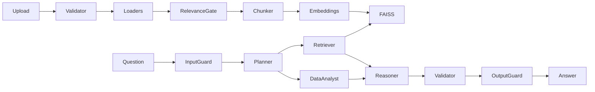

# OnboardIQ build guide

This guide breaks the master plan, [onboarding_agent_capstone.plan.md](onboarding_agent_capstone.plan.md), into 15 small steps (step 14 is split into 14a and 14b). Each step adds one piece and leaves the app in a working state, so if something breaks you know exactly which step caused it.

## How to use each step

Every step file has four sections:

1. **Spec**: what the step builds, which files it creates, and the rules it must follow.
2. **Prompt**: a block you copy into Cursor chat in **Agent** mode. Start a new chat for each step so the context stays small. Each prompt tells the agent to read the master plan, so the agent always has the full picture.
3. **Checkpoint**: PowerShell commands to run yourself, plus the output you should expect. Don't move on until the checkpoint passes.
4. **Common problems**: known pitfalls and how to fix them.

If a checkpoint fails, paste the error into the same chat and ask the agent to fix it. When it passes, commit:

```powershell
git add -A
git commit -m "Step N: <short description>"
```

Committing after every step means you can always roll back with `git reset --hard HEAD` if a later step goes wrong.

## Prerequisites (do these once, before step 1)

| Tool | Check | Install |
| --- | --- | --- |
| uv | `uv --version` | `powershell -c "irm https://astral.sh/uv/install.ps1 \| iex"` |
| git | `git --version` | https://git-scm.com/download/win |
| Groq API key | n/a | Free key at https://console.groq.com/keys |

Keep the Groq key somewhere handy; step 1 puts it in `.env`.

## Windows notes (already built into the prompts)

- **Python 3.11, not 3.14.** Your system Python is 3.14, but `faiss-cpu`, `sentence-transformers` and `torch` may not ship 3.14 wheels yet. Step 1 runs `uv python pin 3.11`, and uv downloads 3.11 for you. Always run things with `uv run ...` so the right interpreter is used.
- **Virtual environment path** is `.venv\Scripts\python.exe` (Linux uses `.venv/bin/python`).
- **First run of the embedding model** downloads about 130 MB from Hugging Face. That's a one-time wait.
- **curl** in PowerShell can be an alias for `Invoke-WebRequest`. The checkpoints use `curl.exe` to get the real curl.

## Sample data

All steps use the data set in `docs/sample_data/` (see [step 2](02_sample_data.md)):
- **Onboarding documents (9 files):** in `pdf/`, `txt/`, `csv/` and `xlsx/`. Wherever a prompt says "the sample documents", it means these four folders.
- **Off-topic files:** `irrelevant/`, which the relevance gate should reject.
- **Broken or unsupported files:** `invalid/`, which the validator should reject.

Step 2 also has a table of questions with known answers that later checkpoints use.

## Progress checklist

- [ ] [01 Scaffold](01_scaffold.md)
- [ ] [02 Sample data](02_sample_data.md)
- [ ] [03 Validator and loaders](03_validator_loaders.md)
- [ ] [04 Groq client](04_groq_client.md)
- [ ] [05 Relevance gate and registry](05_relevance_gate.md)
- [ ] [06 Chunking, embeddings and FAISS](06_chunk_embed_faiss.md)
- [ ] [07 Ingest pipeline](07_ingest_pipeline.md)
- [ ] [08 Agent graph](08_agent_graph.md)
- [ ] [09 Guardrails](09_guardrails.md)
- [ ] [10 FastAPI](10_fastapi.md)
- [ ] [11 Streamlit UI](11_streamlit_ui.md)
- [ ] [12 Debug configs](12_debug_configs.md)
- [ ] [13 Tests and evaluation](13_tests_eval.md)
- [ ] [14a README](14a_readme.md)
- [ ] [14b ARCHITECTURE.md](14b_architecture.md)
- [ ] [15 End-to-end run and demo](15_e2e_demo.md)

## How the pieces fit together



Steps 1 to 7 build the left half (getting documents in). Steps 8 and 9 build the right half (answering questions). Steps 10 and 11 put an API and a UI on top. Steps 12 and 13 cover debugging and testing, steps 14a and 14b the documentation, and step 15 the final demo.

## Tips for working with the agent

- Paste one step at a time. A prompt that asks for everything at once produces code that's hard to check.
- If the agent starts working on a later step's files, tell it to stop and stay within the current step.
- Read the diff before accepting. You'll need to explain this code in your capstone review.
- If you change a design decision (for example, a different Groq model), update the master plan too, so later prompts don't undo your change.
