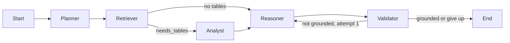

# Step 8: Agent graph (LangGraph)

## Spec

**Goal:** answer questions using five cooperating agents, with citations and a visible trace of what each agent did.

**Files created**
- `app/agents/state.py`: `AgentState` (TypedDict) with these fields:
  - `question`
  - `plan` (question type and sub-tasks)
  - `retrieved` (chunks with scores)
  - `table_results`
  - `draft`
  - `citations`
  - `validation`
  - `attempt`
  - `final_answer`
  - `confidence` (`High` / `Medium` / `Low`)
  - `refused` (bool)
  - `trace` (list of `{agent, summary, ms}`)
- `app/agents/planner.py`, `retriever.py`, `analyst.py`, `reasoner.py`, `validator.py`
- `app/agents/graph.py`: `build_graph()` and `answer_question(question) -> dict`
- `app/agents/prompts.py`: all system prompts in one place
- `scripts/ask.py`
- `tests/test_agents.py`

**What each agent does**
- **Planner:** uses `invoke_json`. Returns `{type: "policy" | "people_lookup" | "schedule" | "mixed", needs_tables: bool, sub_queries: list[str] (1-3), category_hint: str | None}`.
- **Retriever:** runs `vector_store.search` for each sub-query, using the category filter when there's a hint and retrying without it if nothing comes back. Results are de-duplicated by `chunk_id` and the top `settings.top_k` overall are kept.
- **Data Analyst:** runs only when `needs_tables` is true. The LLM picks a table and a query spec as JSON: `{table, filters: [{column, op, value}], columns, sort_by, limit, aggregate}`. Allowed ops are `==`, `!=`, `contains`, `>`, `<`, `>=` and `<=`. Allowed aggregates are `count`, `sum`, `mean`, `min` and `max`. The spec is executed with plain pandas (no `eval` or `query` strings), with at most 50 rows returned. Every table and column name is checked against the real DataFrame.
- **Reasoner:** temperature 0.1. Answers only from the context, citing each claim as `[source, p.N]` or `[source, rows a-b]`. If the context doesn't contain the answer, it must say exactly: "I could not find this in the uploaded onboarding documents."
- **Validator:** uses `invoke_json`. It splits the draft into claims and checks each one against the context, returning `{grounded: bool, unsupported_claims: list[str], has_citations: bool}`. If the draft isn't grounded and `attempt < 2`, the graph goes back to the Reasoner with feedback (one retry). Otherwise the answer is replaced with the refusal sentence.
- **Confidence:** High if top score >= 0.6 and grounded; Medium if score >= 0.45 and grounded; otherwise Low.
- **Short-circuits:** if the index has no chunks, return "No documents uploaded yet. Upload onboarding documents first." without calling the LLM. If retrieval finds nothing and there are no table results, refuse without calling the Reasoner.



## Prompt

```text
Read docs/build_guide/onboarding_agent_capstone.plan.md (section "4. Agents") and docs/build_guide/08_agent_graph.md for the exact spec. This is STEP 8 ONLY: the LangGraph agent graph. No guardrails, API or UI yet.

Add dependency: `uv add langgraph`.

Implement app/agents/state.py, prompts.py, planner.py, retriever.py, analyst.py, reasoner.py, validator.py, graph.py exactly as specified. Every node appends to state["trace"] with agent name, a one-line human-readable summary (e.g. "Planner: people_lookup, 1 sub-query, needs tables"), and elapsed ms. Use invoke_text / invoke_json from app/llm/groq_client.py; catch LLM errors in answer_question and return a friendly message with refused=True rather than raising.

The Data Analyst must never use eval, DataFrame.query, or exec. Build the filter with explicit pandas operations and validate table/column names against the real DataFrame from app/store/tables.py.

answer_question(question) returns {answer, confidence, refused, citations: [{source, page|rows, snippet, score}], trace}.

Create scripts/ask.py: takes the question as an argument (or prompts if missing), runs answer_question, and pretty-prints the answer, confidence, citations, and trace.

Create tests/test_agents.py with offline tests: analyst query executor (filters, aggregate, rejects unknown column), empty-index short circuit, and the graph routing with planner/reasoner/validator LLM calls mocked (validator fails once then passes -> attempt == 2).

Run pytest, then run scripts/ask.py with these questions and show outputs:
"How many PTO days do US employees get per year?", "Who is Siddharth Patel's manager and onboarding buddy?", "How many people work in Platform Engineering?", "When is the next Security Awareness session in IST?", "What is the company's stock price?"
```

## Checkpoint

Make sure the samples are indexed (from step 7), then run:

```powershell
uv run python scripts/ask.py "How many PTO days do US employees get per year?"
uv run python scripts/ask.py "Who is Siddharth Patel's manager and onboarding buddy?"
uv run python scripts/ask.py "How many people work in Platform Engineering?"
uv run python scripts/ask.py "When is the next Security Awareness session in IST?"
uv run python scripts/ask.py "What is the company's stock price?"
uv run pytest -q
```

**Expected output:**
- "20 days" with an `[employee_handbook.pdf, p.N]` citation. A good answer may also mention India's 18 days of earned leave.
- Manager Nisha Chowdary and buddy Abhishek Banerjee, with a `team_directory.csv` rows citation.
- 18, with the Data Analyst showing in the trace.
- Thursday 29 October 2026 at 14:30 IST, citing `training_schedule.xlsx`.
- For the stock price question, the refusal sentence with Low confidence.

## Common problems

- **The answer has `<think>` text in it:** make sure every LLM call goes through `invoke_text` / `invoke_json`, which run `strip_think`.
- **The Validator rejects correct answers:** it's too strict about paraphrasing. Tell it that paraphrases and numbers in a different format count as supported.
- **Infinite loop:** the conditional edge must check `attempt` and the Reasoner node must increment it.
- **People-lookup questions miss:** the planner should set `needs_tables=true` for questions about people, counts and schedules.
