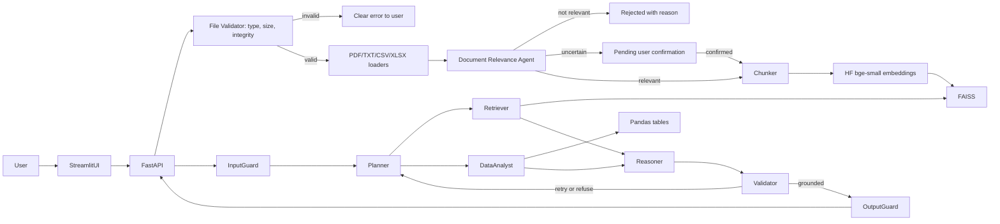

# OnboardIQ - Employee Onboarding Agentic RAG Assistant

## Stack
- Python 3.11, `uv`
- LLM: Groq via `langchain-groq`, model read from `.env`: `GROQ_MODEL=qwen/qwen3.8-27b`, used for all agents (relevance, planner, reasoner, validator)
  - Qwen3 is a reasoning model: call with `reasoning_format="hidden"` (and strip any leftover `<think>...</think>`) so users only see the final answer; JSON outputs (relevance, planner, validator) parsed with structured output + fallback regex
  - Safety moderation: `GROQ_GUARD_MODEL=meta-llama/llama-guard-4-12b` (separate, configurable; if unavailable, falls back to rule-based guard)
  - Startup check calls Groq `/models` to confirm `GROQ_MODEL` exists for the key; shows a clear UI banner if not
- Embeddings: Hugging Face `BAAI/bge-small-en-v1.5` via `sentence-transformers` (free, runs locally, no key)
- Vector DB: FAISS (`langchain_community.vectorstores.FAISS`), persisted to `data/faiss_index/`, metadata kept per chunk
- Agents: LangGraph
- API: FastAPI on port 8766; UI: Streamlit on port 8765
- Loaders: `pypdf` (PDF), plain read (TXT), `pandas` (CSV), `pandas` + `openpyxl` (XLSX)

## API key handling
- `.env` contains `GROQ_MODEL=qwen/qwen3.8-27b`, `GROQ_GUARD_MODEL`, `MAX_FILE_MB=19`, and a working `GROQ_API_KEY` (free key from console.groq.com)
- `.env` stays in `.gitignore` for the git remote (a key pushed to a public repo gets auto-revoked/abused)
- Startup check: if the key is missing/invalid, UI shows a clear banner instead of crashing

## Architecture

## 1. Document reading and validation
Supported: `.pdf`, `.txt`, `.csv`, `.xlsx`, `.xls`. Max size: strictly less than 19 MB (`MAX_FILE_MB=19`, also set `server.maxUploadSize = 19` in `.streamlit/config.toml`).

Validation order (cheap checks first, before any LLM call):
- Empty file -> "File is empty."
- Size >= 19 MB -> "File is 23.4 MB. Maximum allowed is under 19 MB."
- Unsupported extension -> format-specific message, e.g.
  - `.jpg/.png/.gif` -> "Images are not supported. Upload text-based documents (PDF, TXT, CSV, Excel)."
  - `.zip/.rar/.7z` -> "Archives are not supported. Extract the files and upload them individually."
  - `.docx/.pptx` -> "Word/PowerPoint not supported. Export as PDF and re-upload."
  - `.exe`, others -> generic unsupported-format message listing allowed types
- Extension spoofing: check magic bytes (e.g. `photo.jpg` renamed to `.pdf` is rejected)
- Corrupt / password-protected PDF, scanned PDF with no text layer, non-UTF-8 TXT (retry latin-1), malformed CSV, Excel with macros (`.xlsm`) -> specific messages
- Each file processed independently: one bad file in a batch does not block the others; UI shows a per-file result table (status, pages/rows read, chunks created, reason)

"Reading" is demonstrated in the UI: after upload, a document preview panel shows extracted text (first page) or table head, page/row counts, and detected category.

## 2. Document relevance gate (before chunking)
- Profile: filename + first ~2 pages, or sheet names + headers + sample rows
- Groq `GROQ_MODEL` (qwen/qwen3.8-27b) classifies against onboarding categories (HR policy, benefits, IT setup/security, code of conduct, team directory, training schedule, onboarding checklist, payroll/leave, facilities/FAQ) and returns JSON `{relevant, category, confidence, reason}`
- `>= 0.75` relevant -> ingest; confidently irrelevant -> reject with reason; else pending review (user confirms or discards in UI)
- No-key fallback: embedding similarity against onboarding topic descriptions
- Category stored in chunk metadata; decisions logged in SQLite registry with file hash (dedupe)

## 3. RAG
- Chunking: recursive splitter, ~700 tokens, 100 overlap for prose; 25-row groups with headers for tables
- Embeddings: `bge-small-en-v1.5` (384-dim, normalized) -> FAISS inner-product index
- Retrieval: top-k = 5, similarity threshold (e.g. 0.35), optional category filter; below threshold -> refusal path
- Data Analyst queries full CSV/Excel via whitelisted pandas operations for exact lookups

## 4. Agents (LangGraph)
- Planner: classifies question (policy / people-lookup / schedule / mixed) and decomposes into sub-tasks
- Retriever: semantic search over FAISS with metadata filters
- Data Analyst: safe pandas queries over CSV/Excel (whitelisted operations, no `eval`)
- Reasoner: drafts answer strictly from context with citations `[source, page/row]`
- Validator: claim-level grounding check, one retry, then "I could not find this in the uploaded onboarding documents"

## 5. Reliability and safety
Input:
- Question length 3-1000 chars, empty/whitespace rejected
- Prompt-injection pattern filter ("ignore previous instructions", system prompt extraction)
- Llama Guard moderation on the question; unsafe -> polite refusal
- Off-topic detector: non-onboarding questions get a scoped reply
- PII masking (emails, phone, national IDs) in logs

Output / anti-hallucination:
- Answer only from retrieved context (system prompt + temperature 0.1)
- Mandatory citations; Validator rejects uncited claims
- Low-retrieval-score refusal; confidence label (High/Medium/Low) shown in UI
- Llama Guard on final answer
- "No documents uploaded yet" handled before calling the LLM

Errors:
- Groq rate limit / timeout -> retry with exponential backoff (3 tries), then friendly message
- Invalid API key -> startup banner
- Corrupt FAISS index -> rebuild from registry
- Structured logging to `logs/app.log`; no stack traces shown to users

## 6. Self-explanatory UI
Streamlit layout:
- Header: project name, one-paragraph description ("Ask questions about your company's onboarding documents..."), capstone context
- "How it works" expander: 5 steps with the architecture diagram image
- Sidebar "Step 1 - Upload onboarding documents": label lists allowed formats and the < 19 MB limit; `help=` tooltips; per-file result table with status badges (Indexed / Rejected - not onboarding / Pending review / Error)
- "Knowledge base" panel: indexed docs, category, chunk count, delete button
- Main "Step 2 - Ask a question": placeholder text, 4 clickable sample questions
- Answer card: answer, confidence badge, "Sources used" expander with snippets, "Agent steps" expander showing planner -> retriever -> validator trace
- Footer: limitations note (no OCR, English only, answers limited to uploaded docs)
- Status bar: Groq connection, embedding model, number of chunks indexed

## 7. Debugging and launch configs
- `debugpy` added as a dev dependency (`uv add --dev debugpy`); `.vscode/settings.json` points `python.defaultInterpreterPath` to `${workspaceFolder}/.venv/bin/python` and enables pytest discovery
- `.vscode/launch.json` (all `"type": "debugpy"`, `"envFile": "${workspaceFolder}/.env"`, `"justMyCode": false` so breakpoints work inside LangGraph/agents):
  - "API: FastAPI (uvicorn)" - `"module": "uvicorn"`, args `app.api.main:app --host 127.0.0.1 --port 8766 --reload`
  - "UI: Streamlit" - `"module": "streamlit"`, args `run ui/streamlit_app.py --server.port 8765`
  - "Ingest sample data (CLI)" - runs `scripts/ingest_samples.py` to debug validator/relevance/chunking without the UI
  - "Ask a question (CLI)" - runs `scripts/ask.py` with `${input:question}` prompt, to step through the agent graph
  - "Pytest: current file" and "Pytest: all tests" - `"module": "pytest"`
  - "Attach to process (port 5678)"
  - Compound "Full stack: API + UI" - starts API and UI together, `"stopAll": true`
- README section "Debugging": set breakpoints, pick a config from Run and Debug, press F5; plus terminal equivalents (`uv run uvicorn ...`, `uv run streamlit run ...`, `python -m debugpy --listen 5678 ...`)

## Project layout
- `app/config.py`, `app/api/main.py`
- `app/ingestion/{validator,loaders,relevance,chunker,registry}.py`
- `app/store/vector_store.py` (FAISS + HF embeddings)
- `app/agents/{graph,planner,retriever,analyst,reasoner,validator}.py`
- `app/guardrails/{input_guard,output_guard,moderation}.py`
- `app/llm/groq_client.py` (retry/backoff wrapper)
- `ui/streamlit_app.py`, `.streamlit/config.toml`
- `sample_data/` (valid onboarding docs), `sample_data/irrelevant/`, `sample_data/invalid/` (jpg, zip, empty, oversize generator script)
- `.vscode/launch.json`, `.vscode/settings.json`, `scripts/ingest_samples.py`, `scripts/ask.py`
- `tests/`, `.env`, `.env.example`, `README.md`, `ARCHITECTURE.md`

## Mapping to capstone tasks
1. Foundation - uv, config, structure
2. Interaction - FastAPI + self-explanatory Streamlit UI
3. Ingestion - validator + loaders + relevance gate
4. Chunking - prose and table strategies
5. Vector store - HF embeddings + FAISS
6. Retrieval - top-k with threshold and metadata filter
7. RAG - Groq with grounded, cited prompt
8. Agents - LangGraph five-agent graph
9. Safety - input/output guards, Llama Guard, validator loop, error handling
10. Docs - README, ARCHITECTURE.md

## Verification
- Pytest suite including invalid-file cases (jpg, zip, 19+ MB, empty, renamed file)
- End-to-end: upload samples, see rejections for irrelevant/invalid files, ask sample questions, confirm citations and refusals
- Record a short UI walkthrough
